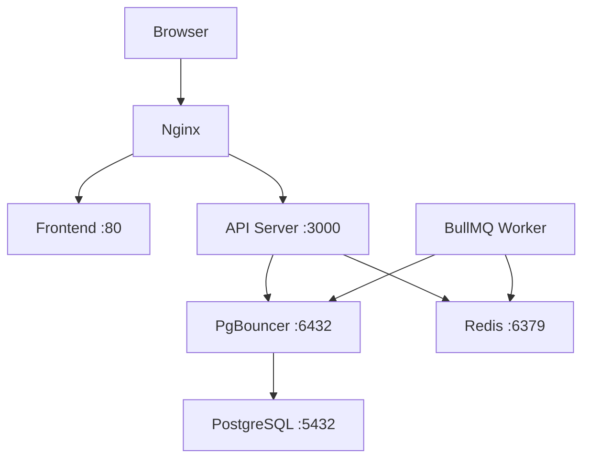

# Развёртывание через Docker Compose

## Архитектура



| Контейнер | Образ | Назначение |
|---|---|---|
| `autoservice_postgres` | postgres:16-alpine | База данных |
| `autoservice_pgbouncer` | bitnami/pgbouncer | Пул соединений с БД |
| `autoservice_redis` | redis:7-alpine | Кэш + очереди BullMQ |
| `autoservice_server` | autoservice/server | NestJS API + WebSocket |
| `autoservice_worker` | autoservice/server | BullMQ worker (тот же образ) |
| `autoservice_frontend` | autoservice/frontend | React SPA (Nginx) |
| `autoservice_nginx` | nginx:1.27-alpine | Reverse proxy, порты 80/443 |

---

## Режим разработки

### Требования

- Docker Desktop ≥ 4.x (или Docker Engine + Compose plugin)
- 4 GB RAM

### Запуск

```bash
# 1. Скопировать и заполнить .env
cp server/.env.example server/.env
# Обязательные поля: DB_PASSWORD, JWT_SECRET
# FRONTEND_URL оставить http://localhost:5173

# 2. Поднять контейнеры (docker-compose.override.yml применяется автоматически)
docker compose up -d

# 3. Применить миграции БД
docker compose exec server npm run db:migrate

# 4. Заполнить тестовыми данными (опционально)
docker compose exec server npm run db:seed
```

После запуска доступно:

| Сервис | URL |
|---|---|
| Frontend (Vite dev) | http://localhost:5173 |
| API + Swagger | http://localhost:3000/api/docs |
| PostgreSQL | localhost:5432 |
| Redis | localhost:6379 |
| PgBouncer | localhost:6432 |

Тестовый аккаунт (после seed): `admin@autoservice.ru` / `Admin1234!`

### Hot reload

В dev-режиме `server/src` и `frontend/src` монтируются в контейнеры — изменения в коде применяются без пересборки.

```bash
# Посмотреть логи сервера в реальном времени
docker compose logs -f server worker

# Перезапустить только сервер
docker compose restart server
```

---

## Продакшен

### Требования

- Сервер: 2 CPU, 4 GB RAM, 20 GB диск
- Docker Engine ≥ 24, Compose plugin ≥ 2.20
- Порты 80 и 443 открыты в firewall

### 1. Подготовить переменные окружения

```bash
cp server/.env.example server/.env
```

Обязательно заполнить:

```env
NODE_ENV=production

# База данных
DB_NAME=autoservice_db
DB_USER=postgres
DB_PASSWORD=<сильный_пароль>

# JWT — сгенерировать: openssl rand -hex 64
JWT_SECRET=<длинная_случайная_строка>

# URL, на котором будет доступен сайт
FRONTEND_URL=https://your-domain.com

# Redis (если нужна аутентификация)
REDIS_PASSWORD=<пароль_redis>

# Google OAuth (если используется)
GOOGLE_CLIENT_ID=...
GOOGLE_CLIENT_SECRET=...
GOOGLE_CALLBACK_URL=https://your-domain.com/auth/google/callback
```

В корневой `.env` (для docker compose) дополнительно:

```env
DB_NAME=autoservice_db
DB_USER=postgres
DB_PASSWORD=<тот_же_пароль>
REDIS_PASSWORD=<тот_же_пароль>
VITE_API_URL=https://your-domain.com
FRONTEND_URL=https://your-domain.com
```

### 2. SSL-сертификаты

Положить сертификаты в `nginx/certs/`:

```bash
nginx/certs/
├── fullchain.pem   # сертификат + цепочка
└── privkey.pem     # приватный ключ
```

Для Let's Encrypt (certbot):

```bash
certbot certonly --standalone -d your-domain.com
cp /etc/letsencrypt/live/your-domain.com/fullchain.pem nginx/certs/
cp /etc/letsencrypt/live/your-domain.com/privkey.pem nginx/certs/
```

> Если SSL не нужен — убрать `443:443` из `docker-compose.yml` и убрать SSL-блок из `nginx/nginx.conf`.

### 3. Запуск

```bash
# Использовать только production compose (без override)
docker compose -f docker-compose.yml up -d --build

# Применить миграции
docker compose exec server npm run db:migrate

# Проверить статус
docker compose ps
docker compose logs -f server
```

### 4. Проверка работоспособности

```bash
# Healthcheck API
curl http://localhost/health

# Все сервисы должны быть healthy/running
docker compose ps
```

---

## Полезные команды

### Логи

```bash
docker compose logs -f                  # все сервисы
docker compose logs -f server worker    # только бэкенд
docker compose logs --tail=100 nginx    # последние 100 строк nginx
```

### Миграции и БД

```bash
# Применить миграции
docker compose exec server npm run db:migrate

# Генерация новой миграции (после изменений схемы)
docker compose exec server npm run db:generate

# Seed тестовыми данными
docker compose exec server npm run db:seed

# Открыть psql
docker compose exec postgres psql -U postgres -d autoservice_db
```

### Масштабирование worker

```bash
# Запустить 3 воркера для обработки очереди уведомлений
docker compose up --scale worker=3 -d
```

### Пересборка образов

```bash
# Пересобрать и перезапустить конкретный сервис
docker compose up -d --build server

# Пересобрать всё
docker compose up -d --build
```

### Остановка и очистка

```bash
# Остановить (данные сохраняются в volumes)
docker compose down

# Остановить и удалить volumes (УДАЛИТ ВСЕ ДАННЫЕ БД!)
docker compose down -v
```

---

## Переменные окружения

### Корневой `.env` (docker compose уровень)

| Переменная | По умолчанию | Описание |
|---|---|---|
| `DB_NAME` | `autoservice_db` | Имя базы данных |
| `DB_USER` | `postgres` | Пользователь БД |
| `DB_PASSWORD` | `postgres` | Пароль БД |
| `REDIS_PASSWORD` | *(пусто)* | Пароль Redis |
| `FRONTEND_URL` | `http://localhost` | URL фронтенда (CORS) |
| `VITE_API_URL` | `http://localhost` | URL API для сборки фронтенда |
| `VITE_APP_NAME` | `АвтоСервис` | Название приложения |
| `NODE_ENV` | `production` | Режим запуска |

### `server/.env`

Полный список с описаниями — в [server/.env.example](../server/.env.example).

Обязательные для работы:

| Переменная | Описание |
|---|---|
| `JWT_SECRET` | Секрет для подписи токенов (`openssl rand -hex 64`) |
| `DB_PASSWORD` | Пароль PostgreSQL |
| `FRONTEND_URL` | URL фронта (для CORS и OAuth-редиректов) |

---

## Troubleshooting

### Сервер не стартует — ошибка соединения с БД

```bash
# Проверить healthcheck postgres
docker compose ps postgres

# Посмотреть логи БД
docker compose logs postgres
```

Причина: postgres ещё не готов. Порядок запуска контролируется `depends_on` + `condition: service_healthy` — дождитесь статуса `healthy`.

### Ошибка `password authentication failed`

Убедиться, что `DB_PASSWORD` в `server/.env` и в корневом `.env` совпадают.

Если меняли пароль после первого запуска — пересоздать volume:

```bash
docker compose down -v
docker compose up -d
```

### Frontend не подключается к API

Проверить `VITE_API_URL` — должен совпадать с адресом, на котором работает nginx. Переменная вшивается в сборку, поэтому после изменения нужна пересборка:

```bash
docker compose up -d --build frontend
```

### WebSocket не подключается

Убедиться, что nginx проксирует `/socket.io/` с заголовками `Upgrade` и `Connection: upgrade` — конфиг уже содержит этот блок. Проверить, что между клиентом и сервером нет дополнительного прокси, который режет WebSocket.

### Накопились логи / диск заканчивается

```bash
# Посмотреть размер логов Docker
docker system df

# Очистить неиспользуемые образы, контейнеры, кэш
docker system prune -f
```
