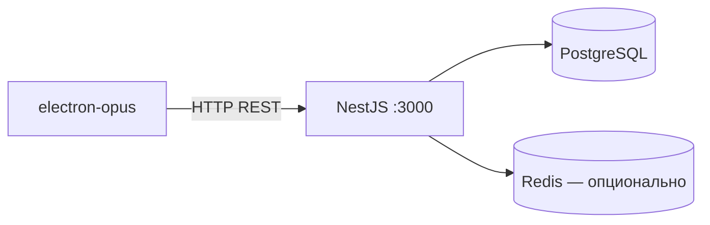

# Установка и запуск Electron-приложения (AutoService Desktop)

Десктоп-клиент находится в каталоге `electron-opus/`. Приложение использует общий UI из `frontend/src` и подключается к NestJS API на порту **3000**.



Структура проекта:

- **Main / Preload** — `electron-opus/src/main`, `electron-opus/src/preload` — окно Electron и preload-скрипт
- **Renderer (UI)** — `frontend/src` — React-приложение, общее с web-версией
- **Сборка** — `electron-vite` + `electron-builder` — dev-сервер и инсталляторы

---

## Требования

На всех платформах (Windows, macOS, Linux) нужны:

- Node.js ≥ 20 LTS
- npm ≥ 10
- Git (актуальная версия)
- Запущенный NestJS API и PostgreSQL — см. [README.md](../README.md)

Для сборки инсталляторов:

- **Windows** — собирать только на Windows; результат: `dist/*-setup.exe` (NSIS)
- **macOS** — собирать только на macOS; результат: `dist/*.dmg`, `dist/*.zip`
- **Linux** — на Linux или через Docker (`electron-opus/Dockerfile`); результат: `dist/*.AppImage`, `dist/*.deb`

Кросс-компиляция ограничена: `build:win` надёжно работает на Windows, `build:mac` — на macOS. Linux-образ можно собрать через Docker без установки Node на хост.

---

## 1. Установка системных зависимостей

### Windows

1. Установить [Node.js 20 LTS](https://nodejs.org/) (вместе с npm).
2. Установить [Git for Windows](https://git-scm.com/download/win).
3. Открыть **PowerShell** или **cmd** от имени обычного пользователя — без «Запуск от администратора» для `npm`.

Проверка:

```powershell
node -v
npm -v
git --version
```

### macOS (POSIX)

```bash
# через Homebrew
brew install node@20 git

# или nvm
curl -o- https://raw.githubusercontent.com/nvm-sh/nvm/v0.40.1/install.sh | bash
nvm install 20
nvm use 20
```

Проверка:

```bash
node -v && npm -v && git --version
```

### Linux (POSIX)

```bash
# Debian / Ubuntu
sudo apt update
sudo apt install -y git curl
curl -fsSL https://deb.nodesource.com/setup_20.x | sudo -E bash -
sudo apt install -y nodejs

# Fedora
sudo dnf install -y git nodejs npm
```

Проверка:

```bash
node -v && npm -v && git --version
```

---

## 2. Клонирование репозитория

### Windows (PowerShell)

```powershell
git clone <repo-url>
cd Automated-autoservice-managment-system-
```

### macOS / Linux

```bash
git clone <repo-url>
cd Automated-autoservice-managment-system-
```

---

## 3. Запуск backend (обязательно)

Electron-клиент не работает автономно: ему нужен запущенный API.

Минимальный локальный вариант — по [README.md](../README.md):

```bash
# 1. Настроить server/.env
cp server/.env.example server/.env
# Заполнить DB_*, DATABASE_URL, JWT_SECRET

# 2. Создать БД и применить схему
cd server
npm install
npm run db:push
npm run db:seed   # опционально — тестовый admin

# 3. Запустить API
npm run start:dev
```

API должен отвечать на **http://localhost:3000** (Swagger: `/api/docs`).

Альтернатива — Docker Compose, см. [DOCKER_DEPLOY.md](./DOCKER_DEPLOY.md).

CORS для Electron уже учтён на сервере (`server/src/cors-origin.callback.ts`): запросы из desktop с origin `null` (file://) разрешены.

---

## 4. Настройка Electron-приложения

### Windows

```powershell
cd electron-opus
copy .env.example .env
npm install
```

### macOS / Linux

```bash
cd electron-opus
cp .env.example .env
npm install
```

Отредактировать `electron-opus/.env`:

```env
# URL backend. Для локальной разработки:
VITE_API_URL=http://localhost:3000

# Заголовок до загрузки tenant-брендинга
VITE_APP_NAME=АвтоСервис
```

Для production-сборки укажите адрес вашего сервера, например `https://api.example.com`.

---

## 5. Режим разработки

В **отдельном** терминале (API уже запущен):

### Windows

```powershell
cd electron-opus
npm run dev
```

### macOS / Linux

```bash
cd electron-opus
npm run dev
```

Откроется окно **AutoService**. Hot reload для renderer включён через `electron-vite`.

### Тестовый вход

После `npm run db:seed` на сервере:

```
Email:    admin@autoservice.ru
Password: Admin1234!
```

---

## 6. Сборка дистрибутива

Сначала идёт production-сборка renderer и main, затем упаковка через `electron-builder`. Артефакты появляются в `electron-opus/dist/`.

- `npm run build:win` — на Windows, NSIS-инсталлятор `autoservice-desktop-*-setup.exe`
- `npm run build:mac` — на macOS, `.dmg` и `.zip`
- `npm run build:linux` — на Linux, `.AppImage` и `.deb`
- `npm run build:unpack` — на любой ОС, распакованная папка без инсталлятора (для проверки)

### Windows

```powershell
cd electron-opus
npm run build:win
```

Установщик: `electron-opus\dist\autoservice-desktop-1.0.0-setup.exe`

### macOS

```bash
cd electron-opus
npm run build:mac
```

При первом запуске неподписанного `.app` macOS может заблокировать приложение: **Системные настройки → Конфиденциальность и безопасность → Всё равно открыть**.

### Linux

```bash
cd electron-opus
npm run build:linux
```

Запуск AppImage:

```bash
chmod +x dist/autoservice-desktop-*.AppImage
./dist/autoservice-desktop-*.AppImage
```

Установка `.deb` (Debian/Ubuntu):

```bash
sudo dpkg -i dist/autoservice-desktop_*_amd64.deb
```

### Сборка Linux через Docker (без Node на хосте)

```bash
cd electron-opus
docker build -t autoservice-desktop-builder .
docker run --rm -v "$(pwd)/dist:/output" autoservice-desktop-builder
```

---

## 7. Полезные команды

В каталоге `electron-opus/`:

```bash
npm run dev          # dev-режим с hot reload
npm run build        # сборка main + renderer без упаковки
npm run preview      # preview production-сборки
npm run build:unpack # dir-сборка для отладки installer
```

---

## 8. Устранение неполадок

### «Не удаётся подключиться к серверу» / пустой экран после логина

- Убедитесь, что API запущен: `curl http://localhost:3000/health` (или откройте Swagger).
- Проверьте `VITE_API_URL` в `electron-opus/.env`.
- После изменения `.env` перезапустите `npm run dev` или пересоберите production-билд.

### `npm install` падает на Windows

- Запускайте терминал **без** прав администратора.
- Удалите `node_modules` и `package-lock.json`, затем снова `npm install`.
- При ошибках native-модулей установите [Visual Studio Build Tools](https://visualstudio.microsoft.com/visual-cpp-build-tools/) с workload «Desktop development with C++».

### Electron не стартует после `npm run dev`

- Проверьте, что порт dev-сервера renderer не занят (electron-vite выберет свой порт автоматически).
- Удалите кэш: `electron-opus/out/` и перезапустите.

### Сборка macOS: entitlements

В `electron-builder.yml` указан `build/entitlements.mac.plist`. Если файла нет в репозитории, создайте каталог `electron-opus/build/` или временно уберите строку `entitlementsInherit` из конфига перед `build:mac`.

### SmartScreen / Gatekeeper блокирует установщик

Production-сборки не подписаны кодом. Для внутреннего использования — подтвердите запуск вручную. Для распространения нужны code signing (Windows Authenticode, Apple Developer ID).

### Не используйте `sudo npm`

На macOS/Linux команды `sudo npm install` / `sudo npm run dev` создают проблемы с правами на `node_modules`. Используйте обычного пользователя или nvm.

---

## Связанная документация

- [README.md](../README.md) — установка сервера и web-frontend
- [DOCKER_DEPLOY.md](./DOCKER_DEPLOY.md) — развёртывание через Docker
- [FT-15-offline-sync.md](./functional-requirements/FT-15-offline-sync.md) — офлайн-режим (сейчас реализован в web, не в desktop)
