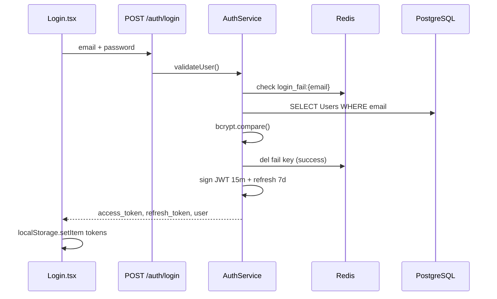

# ФТ-1: Аутентификация и управление доступом

Источник: [FUNCTIONAL_REQUIREMENTS.md](../FUNCTIONAL_REQUIREMENTS.md) §2.3.1

## Требование

Надёжное разграничение прав: регистрация и вход по email/паролю, OAuth Google, JWT access/refresh, ролевая модель, logout с блокировкой токена, auto-refresh, защита от brute-force, безопасное хранение токенов в desktop-приложении.

## Реализация

| Возможность | Статус | Где |
|---|---|---|
| Регистрация email + пароль | ✅ | `POST /auth/register` — `server/src/modules/AuthModule/auth.controller.ts`, `auth.service.ts` |
| Вход email + пароль | ✅ | `POST /auth/login` — `auth.service.ts` → `validateUser()` + `login()` |
| Пароли в bcrypt | ✅ | `bcrypt.hash` / `bcrypt.compare` в `auth.service.ts`; поле `Users.passwordHash` |
| Google OAuth | ✅ | `GET /auth/google`, `GET /auth/google/callback` — `strategies/google.strategy.ts`, `validateGoogleUser()` |
| Access token 15 мин | ✅ | `jwtService.sign(payload, { expiresIn: '15m' })` в `auth.service.ts` |
| Refresh token 7 дней | ✅ | `generateRefreshToken()` — таблица `RefreshTokens`, TTL 7 дней |
| Роли admin / manager / customer | ✅ | `RolesGuard` + `@Roles()` — `guards/roles.guard.ts`, `decorators/roles.decorator.ts` |
| Logout + отзыв refresh | ✅ | `POST /auth/logout` → `revokeRefreshToken()` — удаление из `RefreshTokens` |
| Auto-refresh access | ✅ | RTK Query interceptor — `frontend/src/api/baseApi.ts`, `electron-opus/src/renderer/src/api/baseApi.ts` |
| Brute-force: 5 попыток / 1 мин | ✅ | Redis key `login_fail:{email}` — `auth.service.ts` (`MAX_ATTEMPTS=5`, `BLOCK_TTL=60`) |
| JWT guard на защищённых routes | ✅ | `JwtAuthGuard` — `guards/jwt-auth.guard.ts`; глобально в модулях через `@UseGuards` |
| Публичные endpoints | ✅ | `@Public()` — `decorators/public.decorator.ts` |

### Backend

```
server/src/modules/AuthModule/
├── auth.controller.ts      # REST endpoints
├── auth.service.ts         # login, register, refresh, logout, Google
├── auth.module.ts
├── dto/login.dto.ts
├── dto/register.dto.ts
├── guards/jwt-auth.guard.ts
├── guards/roles.guard.ts
├── strategies/jwt.strategy.ts
├── strategies/google.strategy.ts
└── types/auth.types.ts
```

### Frontend / Electron

| Компонент | Путь |
|---|---|
| Login | `frontend/src/components/Auth/Login.tsx` |
| Register | `frontend/src/components/Auth/Register.tsx` |
| OAuth callback | `frontend/src/components/Auth/AuthCallback.tsx` |
| Protected routes | `frontend/src/components/Auth/ProtectedRoute.tsx` |
| Auth state (Redux) | `frontend/src/store/slices/authSlice.ts` |
| Electron (аналог) | `electron-opus/src/renderer/src/components/Auth/` |

### БД

| Таблица | Файл модели |
|---|---|
| `Users` | `server/src/drizzle/models/auth.model.ts` |
| `Roles` | `server/src/drizzle/models/auth.model.ts` |
| `RefreshTokens` | `server/src/drizzle/models/auth.model.ts` |

## Поток входа



## Тест-кейсы

### TC-1.1 Успешный вход по email и паролю

**Роль:** admin (`admin@gmail.com` / `password123`)

| Шаг | Действие | Ожидаемый результат |
|---|---|---|
| 1 | `POST /auth/login` с email и password | 200, `access_token`, `refresh_token`, объект `user` с role |
| 2 | Запрос `GET /api/v1.0/users/profile/me` с `Authorization: Bearer {access_token}` | 200, профиль admin |
| 3 | Повторный login manager1@gmail.com / password123 | 200, в `user.roleName` — `manager` |

### TC-1.2 Блокировка после 5 неудачных попыток

**Роль:** customer (`user1@gmail.com` / `password123`)

| Шаг | Действие | Ожидаемый результат |
|---|---|---|
| 1 | 5× `POST /auth/login` с неверным password | После 5-й попытки 429 или сообщение о блокировке |
| 2 | 6-й запрос с **верным** password в течение 60 сек | 429 — вход заблокирован |
| 3 | Подождать 60 сек, login с верным password | 200, токены выданы |

### TC-1.3 Refresh, logout и RBAC

**Роль:** manager (`manager1@gmail.com` / `password123`)

| Шаг | Действие | Ожидаемый результат |
|---|---|---|
| 1 | `POST /auth/refresh` с refresh_token | 200, новый access_token |
| 2 | `POST /auth/logout` с refresh_token | 204, refresh удалён из `RefreshTokens` |
| 3 | Повторный refresh со старым refresh_token | 401 Unauthorized |
| 4 | Без токена: `DELETE /api/v1.0/users/:id` | 401; с токеном manager — 403 (только admin) |

## Пробелы

- [ ] Хранение токенов в OS keychain для Electron (сейчас `localStorage`)
- [ ] Явная блокировка access token при logout (сейчас только refresh удаляется; access живёт до истечения 15 мин)
- [ ] Роль `guest` не описана в ТЗ — решить, нужна ли
