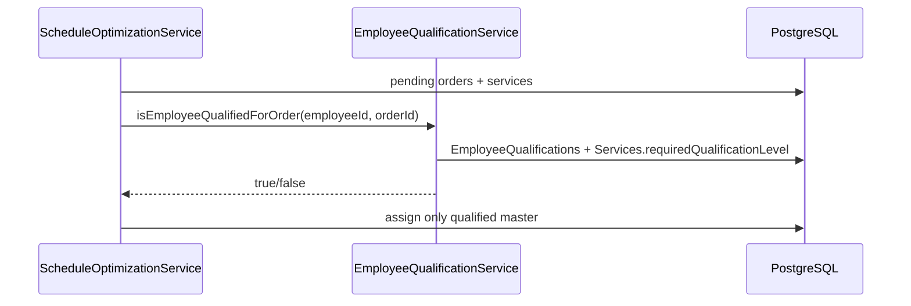

# ФТ-3: Управление сотрудниками

Источник: [FUNCTIONAL_REQUIREMENTS.md](../FUNCTIONAL_REQUIREMENTS.md) §2.3.3

## Требование

Кадровый учёт: карточки сотрудников, квалификации мастеров, расписание смен, подписка на мастера, отзывы, привязка к филиалу.

## Реализация

| Возможность | Статус | Где |
|---|---|---|
| CRUD сотрудников | ✅ | `EmployeeModule` — `GET/POST/PUT/DELETE /api/v1.0/employee` |
| Должность, зарплата, дата приёма | ✅ | `Employees` + `Position` — `staff.model.ts` |
| Контактные данные (email/phone) | ✅ | Из связанного `Users` при `userId` — `employee.service.ts` |
| Справочник квалификаций мастера | ✅ | `WorkTypes` + `EmployeeQualifications` — уровень 1–5 по видам работ |
| Автораспределение по квалификации | ✅ | `ScheduleOptimizationService` + `EmployeeQualificationService` |
| Расписание смен | ✅ | `WorkSchedule` — startTime, endTime, isAvailable |
| Доступность для записи | ✅ | `employee.avalability.service.ts` — cron каждые 5 мин |
| Подписка клиента на мастера | ✅ | `POST/DELETE /api/v1.0/employee/:id/subscribe` |
| Уведомление подписчиков при освобождении | ✅ | `EmployeeAvailabilityService` → `NotificationService.notifyUser()` |
| Отзывы 1–5, soft-delete | ✅ | `Reviews.deletedAt`; `DELETE /employee/:id/reviews/:reviewId` |
| Привязка к филиалу | ✅ | `BranchEmployees` — в ответе `employee.branch` |

### Backend

```
server/src/modules/EmployeeModule/
├── employee.controller.ts
├── employee.service.ts
├── employee-qualification.service.ts
├── employee.avalability.service.ts
├── Dto/create-employee.dto.ts
├── Dto/update-employee.dto.ts
├── Dto/create-review.dto.ts
├── Dto/set-qualifications.dto.ts
└── Dto/subscribe-employee.dto.ts
```

**Ключевые endpoints:**

| Method | Path | Описание |
|---|---|---|
| GET | `/api/v1.0/employee` | Список сотрудников |
| POST | `/api/v1.0/employee` | Создание |
| PUT | `/api/v1.0/employee/:id` | Обновление |
| DELETE | `/api/v1.0/employee/:id` | Удаление |
| GET | `/api/v1.0/employee/work-types` | Справочник видов работ |
| GET | `/api/v1.0/employee/:id/qualifications` | Квалификации мастера |
| PUT | `/api/v1.0/employee/:id/qualifications` | Обновление матрицы квалификаций |
| POST | `/api/v1.0/employee/:id/reviews` | Отзыв клиента |
| GET | `/api/v1.0/employee/:id/reviews` | Список отзывов |
| DELETE | `/api/v1.0/employee/:id/reviews/:reviewId` | Скрытие отзыва (soft-delete) |
| POST | `/api/v1.0/employee/:id/subscribe` | Подписка |
| DELETE | `/api/v1.0/employee/:id/subscribe` | Отписка |

### Frontend

| Компонент | Путь |
|---|---|
| Список | `frontend/src/components/EmployeeComponents/EmployeeList/EmployeeList.tsx` |
| Карточка | `frontend/src/components/EmployeeComponents/EmployeeItem/EmployeeItem.tsx` |
| Форма | `frontend/src/components/EmployeeComponents/EmployeeForm/EmployeeForm.tsx` |
| Подписка | `frontend/src/components/EmployeeComponents/SubscribeModal/SubscribeModal.tsx` |
| Отзыв | `frontend/src/components/EmployeeComponents/ReviewModal/ReviewModal.tsx` |
| API | `frontend/src/api/employeesApi.ts` |

### БД

| Таблица | Поля |
|---|---|
| `Employees` | name, surName, lastName, positionId, hireDate, salary, userId |
| `Position` | name, description (должность) |
| `WorkTypes` | name, description (виды работ для квалификации) |
| `EmployeeQualifications` | employeeId, workTypeId, level (1–5) |
| `WorkSchedule` | employeeId, startTime, endTime, isAvailable |
| `Reviews` | userId, employeeId, rate, description, deletedAt |
| `Subscriptions` | userId, employeeId (уведомление при освобождении) |
| `BranchEmployees` | branchId, employeeId, isPrimary |
| `Services` | workTypeId, requiredQualificationLevel (для matching в FT-10) |

## Поток квалификации при автоназначении



## Пробелы

- [x] Таблица квалификаций: виды работ + уровень мастерства
- [x] Автораспределение с учётом квалификации (FT-10)
- [x] Push-уведомление подписчикам при освобождении мастера
- [x] Контактные данные из связанного `Users`

## Тест-кейсы

### TC-3.1 CRUD карточки сотрудника

| Шаг | Действие | Ожидаемый результат |
|---|---|---|
| 1 | Admin: `POST /employee` с name, surName, positionId, salary | 201, карточка создана |
| 2 | `GET /employee/:id` | Возвращаются ФИО, должность, hireDate, salary |
| 3 | Admin: `PUT /employee/:id` — изменить salary | 200, salary обновлён |
| 4 | Admin: `DELETE /employee/:id` | 204, сотрудник удалён |
| 5 | Client: `POST /employee` | 403 Forbidden |

### TC-3.2 Контактные данные

| Шаг | Действие | Ожидаемый результат |
|---|---|---|
| 1 | Создать сотрудника с `userId`, у пользователя email и phone | — |
| 2 | `GET /employee/:id` | В ответе `contact.email`, `contact.phone` |
| 3 | Сотрудник без `userId` | `contact` отсутствует или null |

### TC-3.3 Справочник квалификаций

| Шаг | Действие | Ожидаемый результат |
|---|---|---|
| 1 | `GET /employee/work-types` | Список видов работ |
| 2 | Manager: `PUT /employee/:id/qualifications` с workTypeId + level 1–5 | 200, матрица сохранена |
| 3 | `GET /employee/:id/qualifications` | Возвращаются workTypeName и level |
| 4 | Дублирующий workTypeId в одном запросе | 400 Bad Request |
| 5 | UI: редактирование сотрудника → блок «Квалификации мастера» | Строки добавляются/удаляются, сохраняются через PUT |

### TC-3.4 Автораспределение по квалификации

| Шаг | Действие | Ожидаемый результат |
|---|---|---|
| 1 | Заказ с услугой: workTypeId=X, requiredLevel=4 | — |
| 2 | Мастер A: level 3 по X; мастер B: level 5 по X | — |
| 3 | `POST /schedule/optimize` | Заказ назначен на мастера B, не на A |
| 4 | `PATCH /schedule/reassign` на мастера без квалификации | Назначение выполнено, в ответе `warning` |
| 5 | Нет подходящего мастера в окне | Заказ в `unscheduled` |

### TC-3.5 Расписание и доступность

| Шаг | Действие | Ожидаемый результат |
|---|---|---|
| 1 | `WorkSchedule`: startTime/endTime в текущем интервале, нет pending-заказа | `isAvailable=true` |
| 2 | Назначить сотруднику pending-заказ | После cron `isAvailable=false` |
| 3 | Завершить/снять заказ, время в смене | `isAvailable=true` |

### TC-3.6 Подписка на мастера

| Шаг | Действие | Ожидаемый результат |
|---|---|---|
| 1 | Client: `POST /employee/:id/subscribe` | 201, подписка на 6 месяцев |
| 2 | Повторная подписка | 400 «already subscribed» |
| 3 | `GET /employee/:id/subscription` | `{ subscribed: true }` |
| 4 | Client: `DELETE /employee/:id/subscribe` | 200, подписка завершена |
| 5 | Мастер становится доступен (cron) | Подписчик получает запись в `Notifications` |

### TC-3.7 Отзывы

| Шаг | Действие | Ожидаемый результат |
|---|---|---|
| 1 | Client: `POST /employee/:id/reviews` rate=4 | 201, отзыв создан |
| 2 | rate=0 или rate=6 | 400 Bad Request |
| 3 | `GET /employee/:id/reviews` | Отзыв в списке |
| 4 | Manager: `DELETE /employee/:id/reviews/:reviewId` | 200, `deletedAt` установлен |
| 5 | Повторный GET reviews | Скрытый отзыв не отображается |

### TC-3.8 Привязка к филиалу

| Шаг | Действие | Ожидаемый результат |
|---|---|---|
| 1 | `BranchModule`: assignEmployee(branchId, employeeId, isPrimary=true) | Запись в `BranchEmployees` |
| 2 | `GET /employee/:id` | `branch.name`, `branch.isPrimary` |
| 3 | UI: карточка сотрудника | Отображается филиал |
