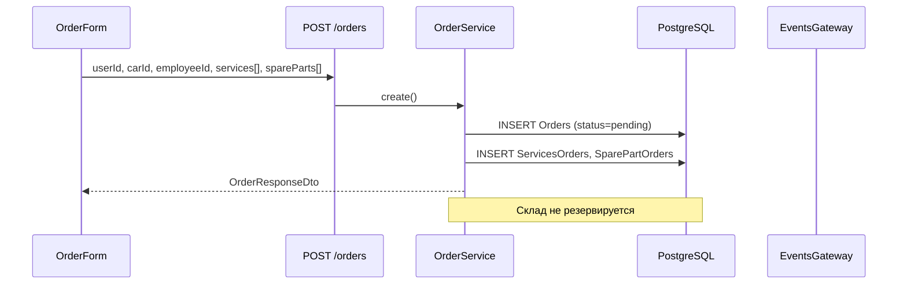

# ФТ-4: Управление заказами и заказ-нарядами

Источник: [FUNCTIONAL_REQUIREMENTS.md](../FUNCTIONAL_REQUIREMENTS.md) §2.3.4

## Требование

Полный цикл заказа: создание заказ-наряда, услуги и запчасти, жизненный цикл, RBAC, оплата, уведомления, резерв/списание склада, печать документов.

## Реализация

| Возможность | Статус | Где |
|---|---|---|
| Создание заказа (клиент, авто, мастер) | ✅ | `OrderModule/order.service.ts` → `create()` |
| Услуги и запчасти в заказе | ✅ | `ServicesOrders`, `SparePartOrders` |
| Статусы заказа | ✅ | `pending`, `diagnosed`, `in_progress`, `quality_check`, `completed`, `cancelled` |
| RBAC: admin/manager — все, client — свои | ✅ | `order.controller.ts` — фильтрация по role |
| Платежи (сумма, способ, статус) | ✅ | `Payment` — `orders.model.ts` |
| Уведомление при смене статуса | ✅ | WebSocket + in-app `NotificationService.notifyUser()` |
| Резерв запчастей при добавлении | ✅ | `StockService.reserveForOrder()` в `order.service.ts` |
| Списание при завершении | ✅ | `StockService.writeOffOnComplete()` при status=completed |
| PDF заказ-наряд / акт / диагностика | ❌ | PDF есть для отчётов и гарантий, не для заказов |
| Производственный пост | ❌ | Нет поля `postId` / `bayId` в `Orders` |
| Планируемое время начала | ❌ | Нет `scheduledStartAt` в заказе (есть в appointments) |

### Backend

```
server/src/modules/OrderModule/
├── order.controller.ts     # GET/POST/PATCH/DELETE /api/v1.0/orders
├── order.service.ts
├── Dto/create-order.dto.ts
└── Dto/order.response.ts
```

**Статусы (фактические):**

```typescript
// frontend/src/utils/orderStatus.ts
pending | in_progress | completed | cancelled
```

### Frontend

| Компонент | Путь |
|---|---|
| Список заказов | `frontend/src/components/OrderComponents/OrderList/OrderList.tsx` |
| Карточка | `frontend/src/components/OrderComponents/OrderItem/OrderItem.tsx` |
| Форма | `frontend/src/components/OrderComponents/OrderForm/OrderForm.tsx` |
| API | `frontend/src/api/ordersApi.ts` |

### БД

| Таблица | Связь |
|---|---|
| `Orders` | userId, carId, employeeId, status, createdAt, completedAt |
| `ServicesOrders` | orderId ↔ servicesId, quantity |
| `SparePartOrders` | ordersId ↔ sparePartId, quantity |
| `Payment` | orderId, amount, status, paymentMethod, paymentDate |

## Поток создания заказа



## Тест-кейсы

### TC-4.1 Создание заказа и резерв запчастей

**Роль:** manager (`manager1@gmail.com` / `password123`)

| Шаг | Действие | Ожидаемый результат |
|---|---|---|
| 1 | `POST /api/v1.0/orders` с userId, carId, employeeId, services[], spareParts[] | 201, status=`pending` |
| 2 | `GET /api/v1.0/stores/movements?orderId={id}` | Запись type=`reserve` |
| 3 | `GET /api/v1.0/stores/:sparePartId` | `reservedQuantity` увеличился |

### TC-4.2 Жизненный цикл и списание склада

**Роль:** manager

| Шаг | Действие | Ожидаемый результат |
|---|---|---|
| 1 | `PUT /api/v1.0/orders/:id` status=`diagnosed` | 200, переход разрешён |
| 2 | status=`in_progress` → `quality_check` → `completed` | 200 на каждом шаге |
| 3 | Проверить `StockMovements` | type=`issue`, quantity списана |
| 4 | `GET /api/v1.0/warranty/order/:orderId` | Автосоздана гарантия на работы |

### TC-4.3 RBAC: клиент видит только свои заказы

**Роль:** customer (`user1@gmail.com` / `password123`)

| Шаг | Действие | Ожидаемый результат |
|---|---|---|
| 1 | `GET /api/v1.0/orders` | Только заказы текущего userId |
| 2 | `GET /api/v1.0/orders/:чужой-id` | 403 или 404 |
| 3 | `PUT /api/v1.0/orders/:id` смена status | 403 Forbidden |

## Пробелы

- [x] Расширенный lifecycle: pending → diagnosed → in_progress → quality_check → completed
- [x] Резерв и списание `SparePartStore` (`StockService`)
- [ ] Генерация PDF: заказ-наряд, акт выполненных работ
- [x] Привязка к производственному посту (`Orders.postId`)
- [x] In-app уведомление клиенту при смене статуса (`NotificationService.notifyUser`)
- [ ] Планируемое время начала (`scheduledStartAt`) в заказе
