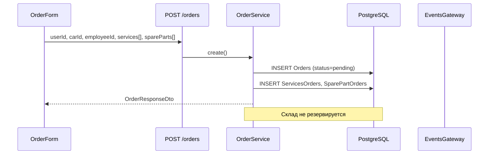

# ФТ-4: Управление заказами и заказ-нарядами

Источник: [FUNCTIONAL_REQUIREMENTS.md](../FUNCTIONAL_REQUIREMENTS.md) §2.3.4

## Требование

Полный цикл заказа: создание заказ-наряда, услуги и запчасти, жизненный цикл, RBAC, оплата, уведомления, резерв/списание склада, печать документов.

## Реализация

| Возможность | Статус | Где |
|---|---|---|
| Создание заказа (клиент, авто, мастер) | ✅ | `OrderModule/order.service.ts` → `create()` |
| Услуги и запчасти в заказе | ✅ | `ServicesOrders`, `SparePartOrders` |
| Статусы заказа | ⚠️ | `pending`, `in_progress`, `completed`, `cancelled` — без `diagnosed`, `quality_control` |
| RBAC: admin/manager — все, client — свои | ✅ | `order.controller.ts` — фильтрация по role |
| Платежи (сумма, способ, статус) | ✅ | `Payment` — `orders.model.ts` |
| Уведомление при смене статуса | ✅ | WebSocket `order:updated` — `EventsGateway.notifyOrderUpdated()` |
| Резерв запчастей при добавлении | ❌ | `create()` только пишет `SparePartOrders`, склад не трогает |
| Списание при завершении | ❌ | `update(status=completed)` не уменьшает `SparePartStore.quantity` |
| PDF заказ-наряд / акт / диагностика | ❌ | PDF есть для отчётов и гарантий, не для заказов |
| Производственный пост | ❌ | Нет поля `postId` / `bayId` в `Orders` |
| Планируемое время начала | ❌ | Нет `scheduledStartAt` в заказе (есть в appointments) |

### Backend

```
server/src/modules/OrderModule/
├── order.controller.ts     # GET/POST/PATCH/DELETE /api/v1.0/orders
├── order.service.ts
├── Dto/create-order.dto.ts
└── Dto/order.response.ts
```

**Статусы (фактические):**

```typescript
// frontend/src/utils/orderStatus.ts
pending | in_progress | completed | cancelled
```

### Frontend

| Компонент | Путь |
|---|---|
| Список заказов | `frontend/src/components/OrderComponents/OrderList/OrderList.tsx` |
| Карточка | `frontend/src/components/OrderComponents/OrderItem/OrderItem.tsx` |
| Форма | `frontend/src/components/OrderComponents/OrderForm/OrderForm.tsx` |
| API | `frontend/src/api/ordersApi.ts` |

### БД

| Таблица | Связь |
|---|---|
| `Orders` | userId, carId, employeeId, status, createdAt, completedAt |
| `ServicesOrders` | orderId ↔ servicesId, quantity |
| `SparePartOrders` | ordersId ↔ sparePartId, quantity |
| `Payment` | orderId, amount, status, paymentMethod, paymentDate |

## Поток создания заказа



## Пробелы

- [ ] Расширенный lifecycle: created → diagnosed → in_progress → quality_control → completed
- [ ] Резерв и списание `SparePartStore`
- [ ] Генерация PDF: заказ-наряд, акт выполненных работ, диагностическая карта
- [ ] Привязка к производственному посту
- [ ] Push/email клиенту при смене статуса (сейчас только WebSocket)
