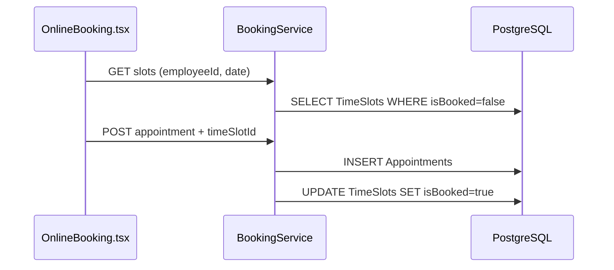

# ФТ-7: Онлайн-запись клиентов

Источник: [FUNCTIONAL_REQUIREMENTS.md](../FUNCTIONAL_REQUIREMENTS.md) §2.3.7

## Требование

Онлайн-запись: временные окна, выбор услуги/мастера/времени, статусы записи, блокировка слота, уведомления, напоминание за 24ч, оптимизация окон.

## Реализация

| Возможность | Статус | Где |
|---|---|---|
| Временные слоты | ✅ | `TimeSlots` — date, startTime, endTime, isBooked |
| Генерация слотов (admin) | ✅ | `POST /api/v1.0/booking/slots/generate` |
| Свободные слоты мастера | ✅ | `GET /api/v1.0/booking/slots?employeeId&date` |
| Создание записи клиентом | ✅ | `POST /api/v1.0/booking` |
| Блокировка слота | ✅ | `createAppointment()` → `isBooked = true` |
| Статусы записи | ✅ | pending, confirmed, in_progress, completed, cancelled, no_show |
| Отмена клиентом | ✅ | `PATCH /api/v1.0/booking/:id/cancel` |
| Код подтверждения | ✅ | `confirmationCode` в `Appointments` |
| Уведомление о подтверждении | ⚠️ | Нет явного email/SMS при create — нужен wiring через NotificationModule |
| Напоминание за 24 часа | ❌ | Cron для appointments отсутствует |
| Алгоритм оптимизации окон | ⚠️ | Частично через ФТ-10 (`ScheduleModule`) |

### Backend

```
server/src/modules/BookingModule/
├── booking.controller.ts   # /api/v1.0/booking
├── booking.service.ts
└── Dto/create-appointment.dto.ts
```

### Frontend

| Компонент | Путь |
|---|---|
| Онлайн-запись | `frontend/src/components/Booking/OnlineBooking.tsx` |
| API | `frontend/src/api/bookingApi.ts` |

### БД

| Таблица | Поля |
|---|---|
| `TimeSlots` | employeeId, date, startTime, endTime, isBooked |
| `Appointments` | userId, carId, serviceId, employeeId, timeSlotId, status, scheduledAt, confirmationCode |

## Поток записи



## Пробелы

- [ ] Cron: напоминание за 24ч до `scheduledAt`
- [ ] Email/SMS при подтверждении записи
- [ ] Endpoint «рекомендованные слоты» с учётом загрузки постов (ФТ-10)
- [ ] Привязка слота к производственному посту
