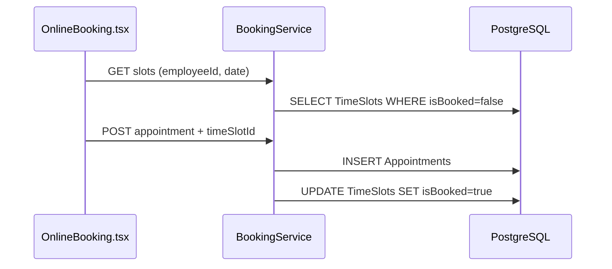

# ФТ-7: Онлайн-запись клиентов

Источник: [FUNCTIONAL_REQUIREMENTS.md](../FUNCTIONAL_REQUIREMENTS.md) §2.3.7

## Требование

Онлайн-запись: временные окна, выбор услуги/мастера/времени, статусы записи, блокировка слота, уведомления, напоминание за 24ч, оптимизация окон.

## Реализация

| Возможность | Статус | Где |
|---|---|---|
| Временные слоты | ✅ | `TimeSlots` — date, startTime, endTime, isBooked |
| Генерация слотов (admin) | ✅ | `POST /api/v1.0/booking/slots/generate` |
| Свободные слоты мастера | ✅ | `GET /api/v1.0/booking/slots?employeeId&date` |
| Создание записи клиентом | ✅ | `POST /api/v1.0/booking` |
| Блокировка слота | ✅ | `createAppointment()` → `isBooked = true` |
| Статусы записи | ✅ | pending, confirmed, in_progress, completed, cancelled, no_show |
| Отмена клиентом | ✅ | `PATCH /api/v1.0/booking/:id/cancel` |
| Код подтверждения | ✅ | `confirmationCode` в `Appointments` |
| Уведомление о подтверждении | ⚠️ | Нет явного email/SMS при create — нужен wiring через NotificationModule |
| Напоминание за 24 часа | ❌ | Cron для appointments отсутствует |
| Алгоритм оптимизации окон | ⚠️ | Частично через ФТ-10 (`ScheduleModule`) |

### Backend

```
server/src/modules/BookingModule/
├── booking.controller.ts   # /api/v1.0/booking
├── booking.service.ts
└── Dto/create-appointment.dto.ts
```

### Frontend

| Компонент | Путь |
|---|---|
| Онлайн-запись | `frontend/src/components/Booking/OnlineBooking.tsx` |
| API | `frontend/src/api/bookingApi.ts` |

### БД

| Таблица | Поля |
|---|---|
| `TimeSlots` | employeeId, date, startTime, endTime, isBooked |
| `Appointments` | userId, carId, serviceId, employeeId, timeSlotId, status, scheduledAt, confirmationCode |

## Поток записи



## Тест-кейсы

### TC-7.1 Онлайн-запись клиента

**Роль:** customer (`user1@gmail.com` / `password123`)

| Шаг | Действие | Ожидаемый результат |
|---|---|---|
| 1 | `GET /api/v1.0/booking/slots?employeeId={id}&date=YYYY-MM-DD` | Свободные слоты (`isBooked=false`) |
| 2 | `POST /api/v1.0/booking` с carId, serviceId, employeeId, timeSlotId | 201, status=`pending`, `confirmationCode` |
| 3 | Повторный GET slots для того же timeSlotId | Слот `isBooked=true` |
| 4 | `GET /api/v1.0/booking/my` | Запись в списке клиента |

### TC-7.2 Отмена записи и генерация слотов

**Роль:** admin + customer

| Шаг | Действие | Ожидаемый результат |
|---|---|---|
| 1 | Admin: `POST /api/v1.0/booking/slots/generate` с employeeId, date, interval | 201, слоты созданы |
| 2 | Customer: `PATCH /api/v1.0/booking/:id/cancel` | 200, status=`cancelled` |
| 3 | GET slot после отмены | `isBooked=false`, слот снова доступен |

### TC-7.3 Уведомления о записи

**Роль:** customer

| Шаг | Действие | Ожидаемый результат |
|---|---|---|
| 1 | Создать запись `POST /api/v1.0/booking` | Job `bookingConfirmation` в очереди |
| 2 | Проверить email / `GET /api/v1.0/notifications/my` | Подтверждение с confirmationCode |
| 3 | Запись за ~24ч — cron `ScheduledNotificationsService` | Напоминание поставлено в очередь |

## Пробелы

- [x] Cron: напоминание за 24ч до `scheduledAt` (`ScheduledNotificationsService`)
- [x] Email при подтверждении записи (`queueBookingConfirmation`)
- [ ] Endpoint «рекомендованные слоты» с учётом загрузки постов (ФТ-10)
- [ ] Привязка слота к производственному посту
