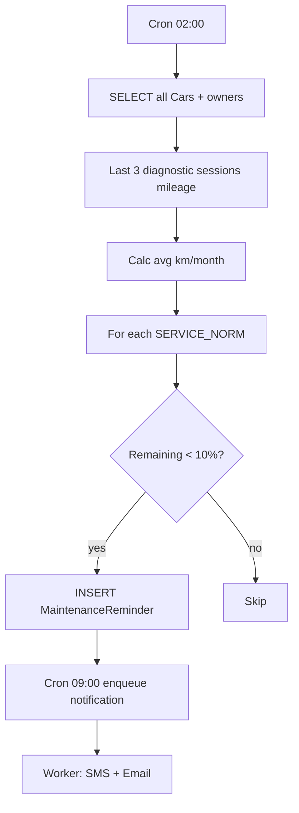

# ФТ-9: Алгоритм предиктивного технического обслуживания

Источник: [FUNCTIONAL_REQUIREMENTS.md](../FUNCTIONAL_REQUIREMENTS.md) §2.3.9

## Требование

Nightly-алгоритм: средний пробег → прогноз интервалов ТО → рекомендации при <10% остатка → уведомления → UI с записью → без дублей → настройка нормативов админом.

## Реализация

| Возможность | Статус | Где |
|---|---|---|
| Автозапуск 1 раз в сутки | ✅ | `@Cron('0 2 * * *')` — `predictive-maintenance.service.ts` |
| Средний пробег (3 последних записи) | ✅ | `processCarPrediction()` — diagnostic sessions |
| Прогноз по km и months | ✅ | `SERVICE_NORMS` + `THRESHOLD = 0.10` |
| Список рекомендаций | ✅ | `MaintenanceReminders` — type, dueDate, dueMileage, reason |
| SMS / email уведомления | ✅ | `NotificationQueueService` → BullMQ worker |
| Без повторных уведомлений | ✅ | `maintenanceReminders.isSent` |
| Cron отправки reminders | ✅ | `ScheduledNotificationsService` — `@Cron('0 9 * * *')` |
| Нормативы по марке/модели (admin) | ❌ | Константы `SERVICE_NORMS` в коде |
| UI рекомендаций + кнопка записи | ⚠️ | API notifications есть; отдельной страницы клиента может не быть |
| Push-уведомления | ⚠️ | WebSocket через `EventsGateway`; native push — нет |

### Backend

```
server/src/modules/NotificationModule/
├── predictive-maintenance.service.ts   # FT-9 core algorithm
├── scheduled-notifications.service.ts  # cron → queue
├── notification.service.ts
├── email.service.ts
└── sms.service.ts

server/src/modules/QueueModule/
├── services/notification-queue.service.ts
└── processors/notification.processor.ts  # worker
```

### БД

| Таблица | Назначение |
|---|---|
| `MaintenanceReminders` | userId, carId, type, dueDate, dueMileage, isSent, isCompleted |
| `DiagnosticSessions` | mileage для расчёта среднего пробега |
| `Cars` | brand, model, year |

## Алгоритм



**Нормативы (захардкожены):**

| type | intervalKm | intervalMonths |
|---|---|---|
| oil_change | 10 000 | 12 |
| tire_rotation | 15 000 | 6 |
| brake_service | 30 000 | 24 |
| scheduled_maintenance | 20 000 | 12 |
| timing_belt | 90 000 | 60 |

## Пробелы

- [ ] Таблица `ServiceNorms` (brand, model, type, intervalKm, intervalMonths) + admin UI
- [ ] Страница клиента «Рекомендуемое ТО» с кнопкой → OnlineBooking
- [ ] Push через Electron/desktop
