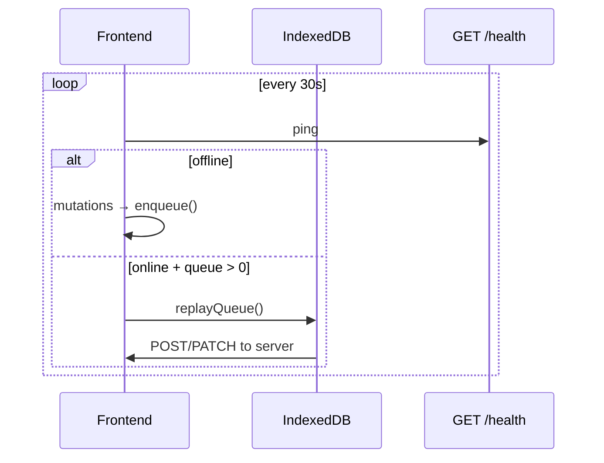

# ФТ-15: Оффлайн-режим и синхронизация данных

Источник: [FUNCTIONAL_REQUIREMENTS.md](../FUNCTIONAL_REQUIREMENTS.md) §2.3.15

## Требование

Полная работа без интернета, локальная очередь, ping каждые 30 сек, conflict resolution по version, status bar, журнал синхронизации.

## Реализация

| Возможность | Статус | Где |
|---|---|---|
| Очередь offline-запросов | ✅ | `frontend/src/offline/syncQueue.ts` — IndexedDB |
| Ping каждые 30 сек | ✅ | `useNetworkStatus.ts` — `PING_INTERVAL = 30_000` |
| Replay при восстановлении | ✅ | `replayQueue()` — timestamp order |
| Status bar | ✅ | `OfflineStatusBar.tsx` |
| Online → offline detection | ✅ | `navigator.onLine` + fetch `/health` |
| Локальное хранение всех данных | ❌ | Только очередь мутаций, не full offline DB |
| Electron offline | ❌ | `electron-opus/` — нет syncQueue / OfflineStatusBar |
| Conflict resolution (version) | ❌ | Нет поля version на Orders и merge logic |
| Журнал синхронизации | ❌ | Нет SyncLog таблицы / UI |
| Полный offline CRUD | ❌ | Read требует сеть; queue только для POST/PATCH/DELETE |

### Frontend (web)

```
frontend/src/
├── offline/syncQueue.ts           # IndexedDB queue
├── hooks/useNetworkStatus.ts      # ping + replay
└── components/OfflineStatusBar/
    └── OfflineStatusBar.tsx
```

**Структура элемента очереди:**

```typescript
interface SyncQueueItem {
  id: string;
  method: "POST" | "PATCH" | "PUT" | "DELETE";
  url: string;
  body?: unknown;
  timestamp: number;
  retries: number;
  maxRetries: number;
}
```

### Electron

Desktop-приложение (`electron-opus/`) использует тот же API layer, но **не включает** offline-модули из `frontend/src/offline/`.

## Поток синхронизации



## Пробелы

- [ ] Портировать offline stack в `electron-opus`
- [ ] Local-first cache (IndexedDB/SQLite) для read operations
- [ ] Поле `version` на mutable entities + last-write-wins / merge
- [ ] `SyncLog` — timestamp, operation, status, error
- [ ] UI журнала синхронизации для admin
