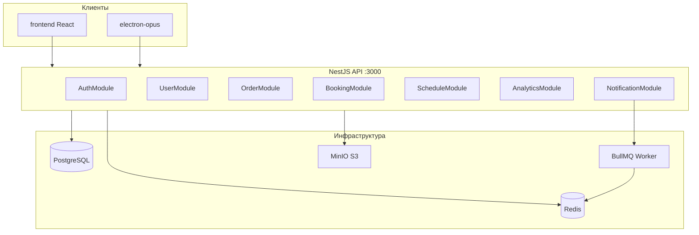

# Карта функциональных требований

Документация реализации по каждому ФТ из [FUNCTIONAL_REQUIREMENTS.md](../FUNCTIONAL_REQUIREMENTS.md).

| ФТ | Название | Документ | Backend-модуль | Статус |
|---|---|---|---|---|
| ФТ-1 | Аутентификация и доступ | [FT-01-authentication.md](./FT-01-authentication.md) | `AuthModule` | ✅ основное готово |
| ФТ-2 | Пользователи и профили | [FT-02-users-profiles.md](./FT-02-users-profiles.md) | `UserModule`, `VehicleModule` | ✅ основное готово |
| ФТ-3 | Сотрудники | [FT-03-employees.md](./FT-03-employees.md) | `EmployeeModule` | ⚠️ нет квалификаций |
| ФТ-4 | Заказы | [FT-04-orders.md](./FT-04-orders.md) | `OrderModule` | ⚠️ упрощённый lifecycle |
| ФТ-5 | Склад и поставщики | [FT-05-warehouse-suppliers.md](./FT-05-warehouse-suppliers.md) | `SpareModule`, `SupplierModule` | ⚠️ нет журнала |
| ФТ-6 | Каталог услуг | [FT-06-services-catalog.md](./FT-06-services-catalog.md) | `ServiceModule` | ✅ основное готово |
| ФТ-7 | Онлайн-запись | [FT-07-online-booking.md](./FT-07-online-booking.md) | `BookingModule` | ⚠️ нет 24h reminder |
| ФТ-8 | Аналитика и отчёты | [FT-08-analytics-reports.md](./FT-08-analytics-reports.md) | `AnalyticsModule`, `ReportService` | ✅ основное готово |
| ФТ-9 | Предиктивное ТО | [FT-09-predictive-maintenance.md](./FT-09-predictive-maintenance.md) | `NotificationModule` | ✅ алгоритм готов |
| ФТ-10 | Оптимизация постов | [FT-10-schedule-optimization.md](./FT-10-schedule-optimization.md) | `ScheduleModule` | ⚠️ ручной запуск |
| ФТ-11 | Диагностика и гарантия | [FT-11-diagnostics-warranty.md](./FT-11-diagnostics-warranty.md) | `DiagnosticsModule`, `WarrantyModule` | ✅ основное готово |
| ФТ-12 | Лояльность и скидки | [FT-12-loyalty-discounts.md](./FT-12-loyalty-discounts.md) | `PromotionsModule` | ⚠️ tiers расходятся с ТЗ |
| ФТ-13 | Корпоративные клиенты | [FT-13-corporate-clients.md](./FT-13-corporate-clients.md) | `CorporateModule` | ⚠️ нет актов/лимитов |
| ФТ-14 | Филиальная сеть | [FT-14-branches.md](./FT-14-branches.md) | `BranchModule` | ⚠️ нет изоляции данных |
| ФТ-15 | Оффлайн и синхронизация | [FT-15-offline-sync.md](./FT-15-offline-sync.md) | — (frontend only) | ⚠️ только web, частично |

## Общая архитектура

## Легенда статусов

| Обозначение | Значение |
|---|---|
| ✅ | Реализовано согласно ТЗ |
| ⚠️ | Частично или с расхождениями |
| ❌ | Не реализовано |
